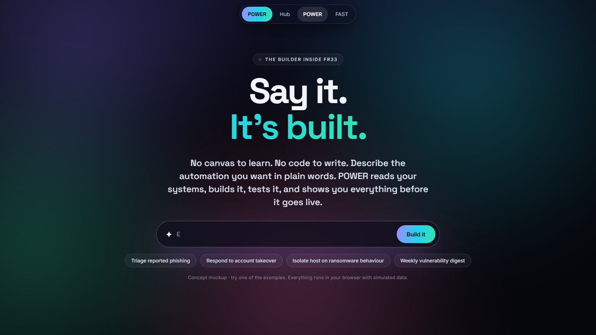
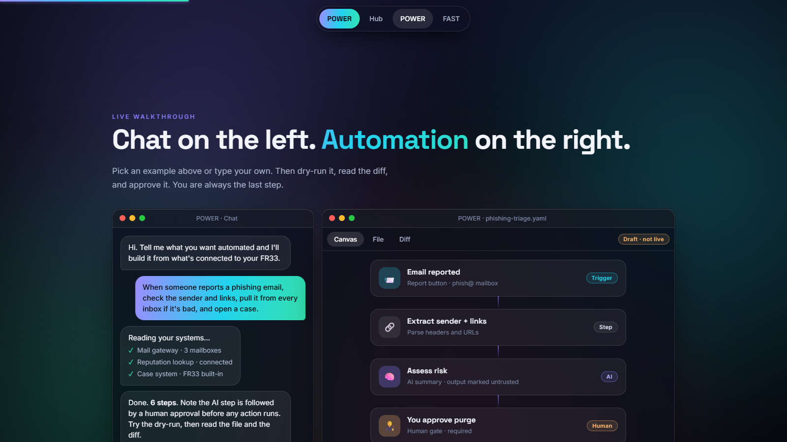

# POWER

**Say it. It's built. Describe an automation in plain words; POWER drafts it, tests it, and shows you everything before it goes live.**

A chat on the left, the automation on the right. Pick an example or type your own, then dry-run it on a sample event,
read the diff when you ask for a change, and approve it. You are always the last step. No canvas to learn, no code to write.
Everything on the page is simulated: no real data, no network calls, no install, no build step.

**Live demo:** https://tootenramen.github.io/POWER/

## The family

| Project | What it is |
|---|---|
| [FR33](https://github.com/Tootenramen/FR33) | the hub: alerts, cases, agents, audit |
| [POWER](https://github.com/Tootenramen/POWER) | describe an automation in plain words; it builds, tests and shows you the diff |
| [FAST](https://github.com/Tootenramen/FAST) | the always-there mentor: it asks small questions until it can write the spec for you |

## What's inside

| Path | What it is |
|---|---|
| `index.html` | the walkthrough page |
| `shared.css`, `shared.js` | the look (aurora glass) and the small dependency-free script behind it |
| `docs/` | screenshots used in this README |

## Use it

1. Visit the live demo, or open `index.html` in any browser.
2. Click an example, press **Dry-run on sample event**, ask for a change, and watch the **Diff** tab.

A concept page: it shows the experience we are building toward, with canned examples. The checklist of what is real
yet lives in the [FR33 repo](https://github.com/Tootenramen/FR33/blob/main/docs/BIBLE.md).

---
Built by [Gustavo Freitas](https://github.com/Tootenramen) - [LinkedIn](https://www.linkedin.com/in/gustavo-freitas-69b93910b/) - [more projects](https://github.com/Tootenramen)
